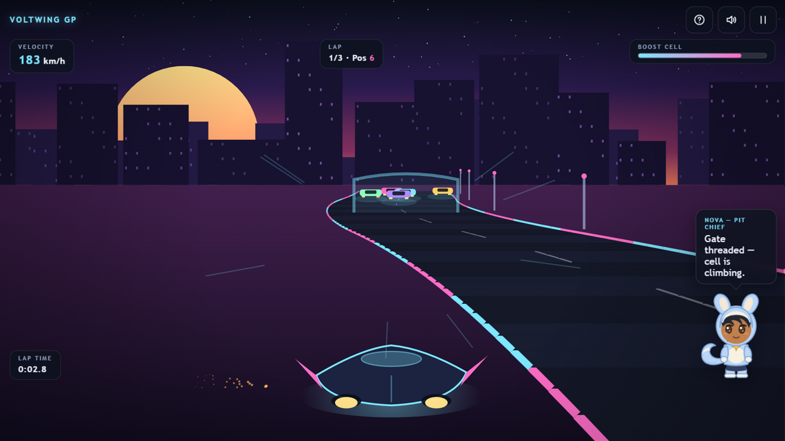
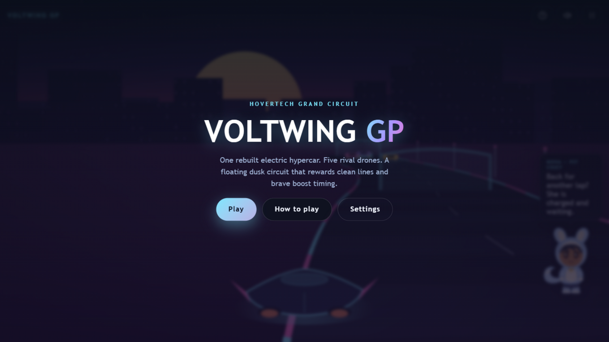

# VOLTWING GP

**Neon hovercar racing in your browser.** One rebuilt electric hypercar, five rival drones, and a floating dusk circuit that rewards clean lines and brave boost timing.

[▶ Play Voltwing GP](https://siddhant-pardeshi.github.io/voltwing-gp/) — free, no install, no login. Runs on phones and desktops.



## The pitch

It is race night above the city. The circuit hovers in the dusk — an energy strip strung between light pylons, its edges glowing cyan on one straight and magenta on the next. You fly the **Voltwing GT**, a salvaged electric hypercar your pit chief Nova rebuilt by hand. Five AI drones share the track with you, and they do not give an inch.

The heart of the game is the **boost cell**. It recharges slowly when you race clean — and jumps when you thread an **orbit gate**, one of the glowing arches parked on the straights. Spend it wisely: a full boost burst down the inside of a bend passes a drone; the same burst into a wall of them costs you a lap.

Three laps. Best total time is saved on your device.



## How to play

| Action | Keyboard | Touch |
| --- | --- | --- |
| Bank left / right | `A` / `D` or arrow keys | Left joystick |
| Boost | `Shift` or `Space` | BOOST button |
| Pause | `Esc` or `P` | Pause icon |

- **Orbit gates** add charge and a burst of speed. Fly through the middle of the arch.
- **Rival drones** hold their lines and punish contact — bumping one scrubs speed off both of you. Overtake in the bends, not on their nose.
- **Off the strip** the car drags through plasma dust and bleeds speed. The light pylons mark the safe edge.
- Full guide with racing tips: [docs/HOW_TO_PLAY.md](docs/HOW_TO_PLAY.md).

## Learn while you race

Between laps, the pit wall raises a **concept board** — a quick question from the Git essentials curriculum (what a commit stores, when to stash, why revert beats force-push). Answer while you keep driving: a correct read patches your boost cell +30. Wrong answers cost nothing but get a one-line explanation from the crew. The **Concepts** screen on the menu tracks mastery — three correct reads masters a card — and the results screen counts what you practiced. Learning mode never blocks the race; skip is always one tap away.

## Nova, your pit chief

The guide in the corner is Nova — she rebuilt the car, and she has opinions. She greets you on your first visit, calls out the grid countdown, reacts when you thread a gate, winces at contact, celebrates laps, and gets drowsy if you pause long enough. She follows the game's events with real animations (waving, cheering, thinking, sleeping) rather than a static picture, and you can hide or mute her in Settings.

How she works and how to swap in your own character: [docs/mascot-guide.md](docs/mascot-guide.md).

## Accessibility & settings

- Master / music / effects volume sliders, mute toggle (`M`)
- Quality tiers (low / balanced / high / auto) for weaker devices
- Reduced motion, camera-shake toggle, hideable mascot
- Fullscreen toggle, keyboard-playable menus, touch targets ≥ 44px
- Every sound has a visual counterpart — the game is fully playable muted

## Under the hood

No engines, no frameworks, no downloaded assets. The track is a segment-projected pseudo-3D circuit rendered with Canvas2D paths every frame; the skyline, sun and cars are drawn geometry; the music and effects are synthesized live with WebAudio. The whole game is a few files of plain JavaScript.

- [docs/HOW_TO_PLAY.md](docs/HOW_TO_PLAY.md) — illustrated guide and strategy
- [docs/mascot-guide.md](docs/mascot-guide.md) — character rig and animation states
- [docs/QA.md](docs/QA.md) — what was tested, and what wasn't

## Run it locally

```bash
python -m http.server 8000
# open http://localhost:8000
```

Any static server works; there is no build step.

## License

MIT — see [LICENSE](LICENSE). Game code, art and audio are original work.

Inspired by classic arcade racers. Not affiliated with or endorsed by any studio or publisher.
